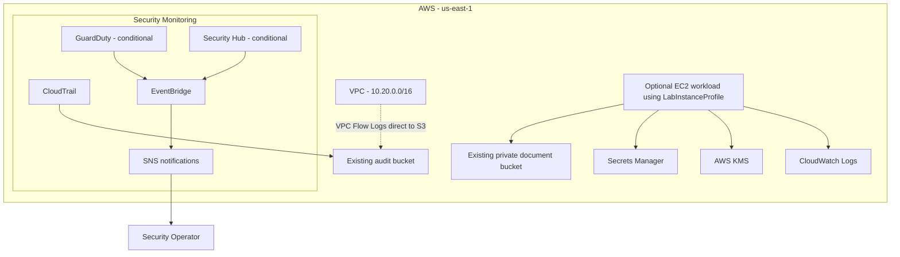

# SecureCloudOps
## Architecture Specification

**Version:** 1.0  
**Status:** Proposed baseline  
**Cloud provider:** Amazon Web Services  
**Deployment environment:** AWS Academy Learner Lab  
**Target region:** `us-east-1`  
**Infrastructure as Code:** Terraform  
**Project type:** Cloud security engineering and automated security operations

---

## 1. Project Overview

### 1.1 Objective

SecureCloudOps is a Terraform-driven AWS environment designed to demonstrate how an enterprise cloud workload can be securely deployed, monitored, protected, and recovered.

The project implements a simulated enterprise document-management platform that stores confidential customer documents and associated business metadata.

The environment combines:

- Secure cloud networking and workload isolation.
- Identity and access management.
- Encryption and secrets management.
- Data protection and retention.
- Centralized logging and threat detection.
- Event-driven security monitoring.
- Controlled incident response.
- Backup and recovery.

The project is intended as an academic security engineering environment, not a production-ready enterprise platform.

### 1.2 Main scenario

A small enterprise operates a document-management application used by employees to manage customer documents.

The application relies on:
- An application server hosted on Amazon EC2.
- Amazon RDS for structured business metadata.
- Amazon S3 for document storage.
- AWS KMS for encryption.
- AWS Secrets Manager for application credentials.

The security environment must protect these resources against unauthorized access, data exposure, suspicious workload activity, and accidental or malicious data loss.

When a security finding occurs, the platform must detect it, classify it, record relevant evidence, and notify the security operator. Controlled containment of designated laboratory resources is an optional later capability.

### 1.3 Project goals

1. Deploy a logically segmented AWS environment.
2. Enforce least-privilege access for users and workloads.
3. Protect stored documents, database records, and credentials.
4. Collect and monitor security-relevant events.
5. Detect suspicious activity using AWS security services.
6. Automate security alert processing and controlled response.
7. Demonstrate backup, retention, and recovery mechanisms.
8. Manage infrastructure through reusable Terraform modules.

---

## 2. High-Level Architecture

The architecture is divided into six logical domains:

| Domain | Responsibility |
|---|---|
| Identity and access | Authentication, authorization, temporary credentials |
| Network and workloads | Network isolation and application infrastructure |
| Data protection | Storage, encryption, secrets, retention |
| Security monitoring | Logging, threat detection, centralized findings |
| Incident response | Event processing, notification, controlled containment |
| Backup and recovery | Backup policies, retention, restoration |

### 2.1 Architecture diagram

The following is the permission-constrained Learner Lab deployment. EC2 is optional; the application workload is not created by the current baseline.



The existing S3 buckets are preserved but their base bucket resources are not managed by Terraform because the organization SCP denies the provider's Object Lock configuration read. Terraform continues to manage supported bucket security subresources and bucket policies.

---

## 3. Network and Workload Architecture

### 3.1 VPC

Create one dedicated VPC:

- Name: `securecloudops-vpc`
- CIDR: `10.20.0.0/16`
- Region: `us-east-1`
- Availability zones: two for the target architecture

### 3.2 Subnet layout

| Subnet | CIDR | Purpose |
|---|---|---|
| Public AZ-1 | `10.20.0.0/24` | Public-facing load balancer |
| Public AZ-2 | `10.20.1.0/24` | Public-facing load balancer |
| Application AZ-1 | `10.20.10.0/24` | Application workloads |
| Application AZ-2 | `10.20.11.0/24` | Application workloads |
| Database AZ-1 | `10.20.20.0/24` | Private database tier |
| Database AZ-2 | `10.20.21.0/24` | Private database tier |

The actual Availability Zone names will be discovered dynamically by Terraform.

### 3.3 Network components

- Amazon VPC.
- Internet Gateway.
- Public and private route tables.
- Subnet associations.
- Security Groups.
- Network ACLs where justified.
- VPC Flow Logs delivered directly to the existing audit S3 bucket; no custom IAM delivery role.

### 3.4 Network security rules

**Public load balancer**
- Accept HTTPS traffic on TCP/443.
- No unrestricted administrative access.

**Application tier**
- Accept application traffic only from the load balancer Security Group.
- No direct public SSH access.
- Access to the database only through the required database port.
- Restrict access to AWS services through appropriate endpoints or controlled egress.

**Database tier**
- No public IP address.
- Accept database connections only from the application Security Group.
- Use encryption at rest.

Security Groups are the primary workload-level access control. Network ACLs provide additional subnet-level filtering where useful.

### 3.5 Network cost policy

A NAT Gateway will not be enabled by default in the Academy environment.

The private workloads will use the minimum required connectivity, such as an S3 Gateway Endpoint and selected interface endpoints, where permitted and economically justified.

A full production deployment may require controlled outbound connectivity.

---

## 4. Identity and Access Management

### 4.1 Identity model

All access must follow least privilege.

The project uses:

- AWS Academy temporary credentials for the deployment operator.
- The pre-provisioned `LabRole` and `LabInstanceProfile` when an EC2 workload is explicitly enabled.
- AWS STS temporary credentials.
- Local Terraform/IaC policy checks instead of IAM Access Analyzer.

No permanent AWS access keys will be embedded in application code or Terraform configuration.

The deployment must not create IAM roles or instance profiles. The lab's `LabRole` and `LabInstanceProfile` have been verified to exist; the role trust policy allows EC2 and Lambda, and the caller's simulated `iam:PassRole` decision is allowed. The role is not trusted by the VPC Flow Logs service. Reusing the role does not make it least-privilege; do not attach it to a workload until the workload's required permissions and the role's broad lab permissions have been reviewed.

### 4.2 Workload identity limitation

The current baseline creates no EC2 workload. A future test instance may reference `LabInstanceProfile` without creating or changing IAM resources. Its permissions are controlled by the Academy and are not equivalent to a dedicated least-privilege application role.

---

## 5. Data Protection Architecture

### 5.1 Amazon S3

The document-management platform uses the existing private S3 document bucket and audit bucket. The bucket bases are preserved outside Terraform state because an organization SCP denies `s3:GetBucketObjectLockConfiguration`, which the provider calls while refreshing `aws_s3_bucket`. Terraform manages supported security subresources and bucket policies separately.

Security configuration:

- S3 Block Public Access enabled.
- Bucket versioning enabled.
- Server-side encryption using AWS KMS.
- HTTPS-only bucket access.
- Restricted bucket policies.
- Application role access limited to the required bucket and prefixes.
- S3 Object Lock is excluded because its configuration API is explicitly denied.
- Lifecycle policies for archival.

### 5.2 KMS

Use AWS KMS customer-managed keys where permissions and account capabilities allow.

Encryption targets:

- S3 document objects.
- RDS database storage.
- EC2 EBS volumes.
- Backup resources where supported.

Key policies must grant access only to authorized identities and services.

### 5.3 Secrets Manager

Database credentials and other application secrets are stored in AWS Secrets Manager.

Application instances retrieve credentials at runtime through their IAM role.

Secrets must never be:
- Committed to Git.
- Stored in Terraform source code.
- Passed through unprotected user data.
- Written to application logs.

### 5.4 Amazon Macie

Macie is used to inspect the S3 document bucket for potentially sensitive data.

Its purpose is to demonstrate data discovery and identify potential accidental exposure of sensitive information.

Macie deployment is conditional on Academy permissions and service costs.

### 5.5 S3 Object Lock and Glacier

S3 Object Lock is excluded from the Learner Lab deployment because the organization SCP denies the provider's Object Lock configuration read. Do not configure Object Lock or attempt to work around the SCP.

S3 Glacier lifecycle transitions remain a conditional enhancement and require a separate cost and permission review.

---

## 6. Application and Database Architecture

### 6.1 Amazon EC2

EC2 hosts the document-management application.

Security requirements:

- Deployed in the private application subnet.
- Encrypted EBS storage.
- The pre-provisioned `LabInstanceProfile` only after a permission review.
- Restricted Security Group.
- No SSH from the public internet.
- Centralized application logging.
- Administrative access through an authorized management channel where available.

No EC2 instance is included in the baseline. A single test instance is a later conditional step; the Learner Lab profile is broader than a dedicated application role.

### 6.2 Amazon RDS

RDS stores structured application metadata, such as:

- Document identifiers.
- Document names.
- Customer references.
- Document status.
- Creation timestamps.
- Ownership and access metadata.

Security requirements:

- Private database subnets.
- Public accessibility disabled.
- Encryption at rest.
- Credentials retrieved from Secrets Manager.
- Network access restricted to the application tier.
- Backup policy attached through AWS Backup.

### 6.3 AWS Certificate Manager

ACM supplies the TLS certificate used by the public-facing load balancer.

ACM Private CA is not included in the initial implementation because it introduces additional complexity and cost without being necessary for the project's core scenario.

---

## 7. Security Monitoring and Threat Detection

### 7.1 AWS CloudTrail

CloudTrail records AWS API activity.

The project uses it to audit administrative and infrastructure operations.

Requirements:
- Capture management events.
- Store logs in a dedicated protected S3 bucket.
- Integrate with CloudWatch Logs where supported.
- Consider data events for the document bucket as a separately costed enhancement.

### 7.2 Amazon CloudWatch

CloudWatch provides centralized observability.

It receives or monitors:
- Application logs.
- EC2 operating metrics.
- CloudTrail events where configured.
- Security-related alarms.

VPC Flow Logs are delivered directly to S3 to avoid creating a CloudWatch delivery role.

### 7.3 Amazon GuardDuty

GuardDuty analyzes supported AWS telemetry to identify suspicious activity.

Examples:
- Suspicious API activity.
- Potentially compromised EC2 workloads.
- Unusual network behavior.
- Threat indicators reported by GuardDuty.

### 7.4 AWS Security Hub

Security Hub provides a centralized view of supported security findings.

It is used to consolidate and review security information from integrated AWS services.

### 7.5 Local IaC policy checks

IAM Access Analyzer is excluded because the Learner Lab denies its tagging operation.

Use local Terraform validation and a Terraform security scanner (for example, Checkov) to inspect infrastructure configuration. Record the scanner version and findings with the validation evidence. These checks do not replace account-level external access analysis.

### 7.6 Amazon Macie

Macie identifies potentially sensitive information in S3 and helps identify data exposure risks.

---

## 8. Incident Response Architecture

### 8.1 Event-driven workflow

The response pipeline uses:

- GuardDuty.
- Security Hub.
- Amazon EventBridge.
- Amazon SNS.

Workflow:

1. A monitored AWS service generates a security finding.
2. EventBridge receives the matching event.
3. EventBridge publishes the event directly to the SNS topic.
4. The security operator reviews and classifies the finding manually.

### 8.2 Initial response mode

The implementation uses **notification and manual response only**. Lambda is not deployed because it requires an execution role.

This avoids accidentally isolating legitimate resources or modifying critical infrastructure.

### 8.3 Optional controlled containment

A later implementation may isolate a dedicated test EC2 instance by attaching a quarantine Security Group, if the lab's existing role and permissions allow it.

Containment requirements:

- Only explicitly designated laboratory instances are eligible.
- The target must carry the expected project and resource tags.
- The existing lab role must be reviewed; it cannot be narrowed by this project.
- The action must be logged.
- The behavior must be reversible.
- Automatic containment must be disabled by default.

Automated response is out of scope for the Learner Lab baseline. No function will delete resources, modify IAM policies, or disable security monitoring.

---

## 9. Backup and Recovery Architecture

### 9.1 AWS Backup

AWS Backup protects supported compute and database resources.

Initial targets:
- EBS volumes associated with the test workload.
- RDS database instances.

### 9.2 Backup Audit Manager

Backup Audit Manager is used to evaluate backup policy compliance and report deviations where supported.

### 9.3 Recovery validation

A backup is not considered successful merely because it exists.

The project must demonstrate:
- A successful backup operation.
- A restore operation into an isolated test environment.
- Verification that restored data is accessible.
- Recording of restoration results.

Retention periods are configurable and must be selected according to Academy limits and cost constraints.

---

## 10. Terraform Architecture

Terraform is the infrastructure source of truth.

The project will use reusable, independently understandable modules.

```text
SecureCloudOps/
│
├── terraform/
│   ├── environments/
│   │   └── dev/
│   │       ├── main.tf
│   │       ├── provider.tf
│   │       ├── variables.tf
│   │       ├── outputs.tf
│   │       └── versions.tf
│   │
│   └── modules/
│       ├── networking/
│       ├── identity/
│       ├── incident-response/
│       ├── monitoring/
│       └── storage/
│
├── security/
│   ├── environment.md
│   ├── capability-matrix.md
│   ├── threat-model.md
│   ├── test-cases.md
│   └── findings.md
│
├── docs/
│   ├── architecture.md
│   ├── deployment.md
│   └── recovery-procedure.md
│
├── scripts/
│   ├── check-capabilities.sh
│   └── cleanup.sh
│
├── .gitignore
└── README.md
```

### 10.1 Terraform rules

- Terraform is the source of truth for managed infrastructure.
- Use variables for environment-specific configuration.
- Use outputs to expose module interfaces.
- Use data sources to discover supported Availability Zones and account metadata.
- Commit `.terraform.lock.hcl`.
- Do not commit Terraform state.
- Do not commit credentials or secret variable files.
- Keep state local until an appropriate remote backend is verified and configured.
- Use common resource tags.
- Document resource cleanup and retention exceptions.
- Do not declare the existing S3 bucket bases as `aws_s3_bucket` resources; the organization SCP denies the Object Lock configuration read Terraform performs during refresh.
- Back up local state before removing only the two base bucket addresses from Terraform state. This preserves the AWS buckets; it does not delete them.

The AWS Academy execution role and instance profile are externally supplied. Terraform reads `LabInstanceProfile` and never creates, replaces, or administers IAM roles.

---

## 11. Service Scope and Implementation Priority

The architecture covers the following services from the course.

| AWS service | Architectural role | Priority |
|---|---|---|
| IAM | Pre-provisioned lab identity | Conditional |
| STS | Temporary credentials | Core |
| IAM Access Analyzer | External access assessment | Excluded (tag permission denied) |
| VPC | Network isolation | Core |
| EC2 | Application workload | Core |
| EBS | Workload storage | Core |
| S3 | Document storage and audit logs | Core |
| KMS | Encryption | Core |
| Secrets Manager | Credential protection | Core |
| CloudTrail | API auditing | Core |
| CloudWatch | Monitoring and logging | Core |
| EventBridge | Security event routing | Core |
| Lambda | Response automation | Excluded (execution role unavailable) |
| GuardDuty | Threat detection | Conditional |
| Security Hub | Centralized findings | Conditional |
| Macie | Sensitive data discovery | Conditional |
| RDS | Relational data storage | Conditional |
| ACM | TLS certificate management | Conditional |
| S3 Object Lock | Retention protection | Conditional |
| S3 Glacier | Long-term archival | Conditional |
| AWS Backup | Backup and restore | Conditional |
| Backup Audit Manager | Backup compliance assessment | Conditional |

**Core** means necessary to the project's logical foundation. **Conditional** means deployment depends on Academy permissions, service availability, and acceptable costs. These classifications do not imply that every service has already been verified in the account.

### 11.1 Services deliberately excluded from the baseline

- **AWS Directory Service and Amazon WorkSpaces:** Not required for the selected document-management scenario.
- **ACM Private CA:** Not required for the initial TLS use case.
- **DynamoDB:** RDS is the selected structured metadata database.
- **Elastic Beanstalk:** EC2 is the selected application compute model. Beanstalk could replace this deployment approach in a future variant.

These exclusions are architectural choices, not claims that the services are unavailable.

---

## 12. Implementation Phases

### Phase 0 - Environment readiness

- Verify AWS Academy credentials.
- Identify account and region.
- Inspect service permissions.
- Verify quotas and resource availability.
- Establish cost and cleanup constraints.

### Phase 1 - Secure foundation

- Terraform environment.
- VPC and subnet architecture.
- Security Groups and route tables.
- Reference the existing Academy instance profile only if an EC2 test workload is enabled.
- KMS foundations.
- CloudTrail.
- VPC Flow Logs.

### Phase 2 - Workload and data protection

- EC2 test workload.
- EBS encryption.
- S3 document bucket.
- KMS encryption.
- Secrets Manager.
- RDS if available.
- ACM and load balancer if justified.

### Phase 3 - Security monitoring

- CloudWatch logging and alarms.
- GuardDuty.
- Security Hub.
- Macie.
- Local Terraform policy scanning.
- EventBridge rules.

### Phase 4 - Automated response

- EventBridge-to-SNS notification.
- Manual finding classification and response.

### Phase 5 - Backup and validation

- AWS Backup.
- Backup Audit Manager.
- S3 retention and lifecycle.
- Restore validation.
- Security test execution.
- Architecture and results documentation.

The phases may be split into smaller Terraform deployment increments to accommodate the temporary Academy environment.

---

## 13. Security Validation Scenarios

The final project must demonstrate security controls through tests, not just resource creation.

| ID | Scenario | Expected result |
|---|---|---|
| SC-01 | Attempt public access to the document bucket | Access denied |
| SC-02 | Attempt database access from an unauthorized network source | Connection denied |
| SC-03 | Attempt application access without authorized credentials | Access denied |
| SC-04 | Inspect S3 encryption configuration | KMS encryption confirmed |
| SC-05 | Inspect EC2 storage configuration | EBS encryption confirmed |
| SC-06 | Generate a controlled security test event | Finding is processed |
| SC-07 | Trigger an EventBridge rule with a synthetic event | SNS topic receives the event |
| SC-08 | Review a simulated security finding | Operator receives the notification and records a manual disposition |
| SC-09 | Inspect IaC for insecure settings | Local Terraform security scanner results are reviewed |
| SC-10 | Restore a protected workload resource | Restored resource is validated |

Tests must be performed only against resources in the designated project environment.

---

## 14. Architectural Constraints and Risks

1. AWS Academy permissions can prevent creation or configuration of certain resources.
2. Temporary credentials may expire during implementation.
3. Some security services generate usage-based charges.
4. Multi-AZ deployments, load balancers, NAT Gateways, interface endpoints, and database resources may increase cost.
5. Some services require account-level enablement or service-linked roles.
6. S3 Object Lock retention can make cleanup difficult or impossible before the retention period expires.
7. Academy environments can reset, terminate, or restrict resources.

The architecture must be adapted when a capability is unavailable, but alternatives must preserve the intended security objective wherever possible.

---

## 15. Architectural Decision Register

| ID | Decision | Rationale |
|---|---|---|
| ADR-001 | Use Terraform | Reproducible infrastructure and IaC practice |
| ADR-002 | Use `us-east-1` | Selected project region |
| ADR-003 | Use AWS Academy | Educational deployment environment |
| ADR-004 | Model a document-management workload | Coherent scenario for multiple security domains |
| ADR-005 | Reuse the pre-provisioned LabRole only when needed | IAM role creation is denied; the role is broad and must be reviewed |
| ADR-006 | Use EC2 and RDS as the primary application stack | Explicit workload and database security controls |
| ADR-007 | Use S3 and KMS for document protection | Central data protection mechanism |
| ADR-008 | Route EventBridge findings directly to SNS | Lambda execution-role creation is unavailable; operator response stays manual |
| ADR-009 | Begin with notification-only response | Avoid unsafe automatic containment |
| ADR-010 | Avoid NAT Gateway by default | Control laboratory costs |
| ADR-011 | Separate target architecture from lab deployment | Preserve architectural intent despite Academy limitations |
| ADR-012 | Require validation before claiming a control works | Evidence-based security testing |
| ADR-013 | Preserve existing S3 bucket bases outside Terraform state | The SCP explicitly denies the Object Lock API call made by `aws_s3_bucket` refresh |
| ADR-014 | Replace Access Analyzer with local IaC scanning | The lab denies Access Analyzer tagging |

---

## 16. Definition of Done

SecureCloudOps is complete when:

- The implemented infrastructure can be reproduced using Terraform.
- The network and workload boundaries are documented and validated.
- IAM resources are not created by the project; any reused lab role is reviewed and documented.
- Data storage and encryption controls are tested.
- Relevant AWS activity is logged.
- Available detection services are configured and tested.
- Security findings can be processed and notifications delivered.
- Backup and restoration are demonstrated where the services are available.
- Security test results and limitations are documented.
- Resources can be cleaned up safely without violating retention requirements.

**Final principle:** The architecture defines the desired security properties. Terraform implements them, AWS services enforce them, and the test results provide evidence that they work.